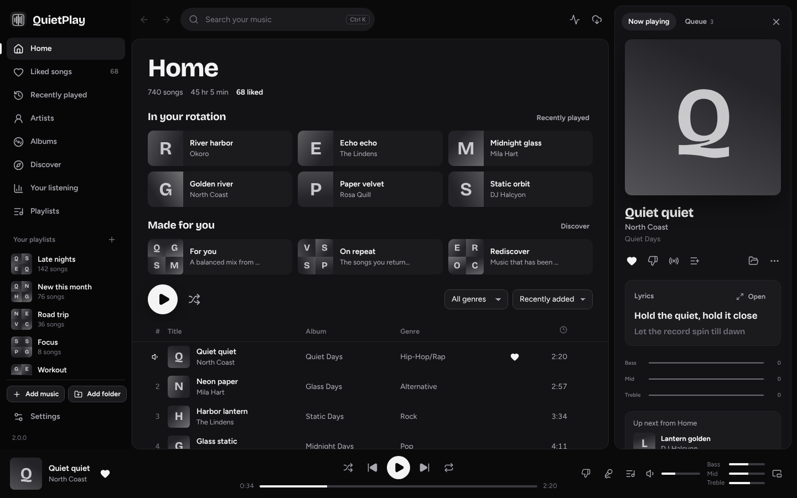
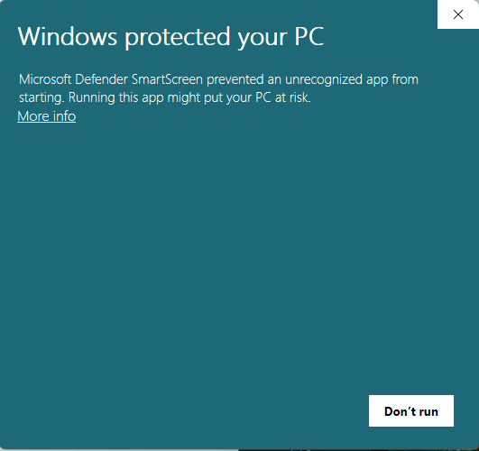
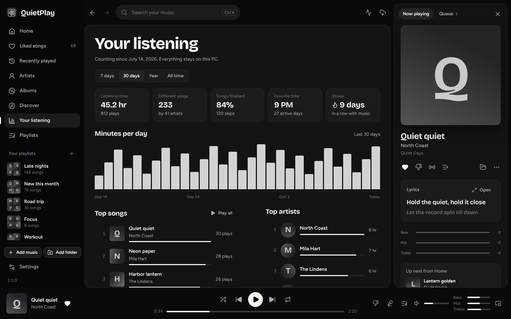

# QuietPlay

**A music player for the songs on your PC, that learns what you like.**

QuietPlay 2.0 is a redesigned Windows app: a clean black-and-grey interface,
synced lyrics, smart mixes and radio built only from your own listening, your
listening stats, playlists, a mini player, Windows media controls and OBS
streaming tools. No account, no subscription and no upload of what you play.

**[Download QuietPlay 2.2 for Windows](#get-quietplay)** &nbsp; / &nbsp;
**[Install guide](#install-quietplay)** &nbsp; / &nbsp;
**[What's new](CHANGELOG.md)** &nbsp; / &nbsp;
**[Request a feature](https://github.com/cooperwwwwww/QuietPlay-downloads/issues/new?template=feature_request.yml)** &nbsp; / &nbsp;
**[Report a bug](https://github.com/cooperwwwwww/QuietPlay-downloads/issues/new?template=bug_report.yml)**

[User guide](USER_GUIDE.md) | [FAQ](FAQ.md) | [Changelog](CHANGELOG.md) |
[Platforms](PLATFORMS.md) | [Roadmap](ROADMAP.md) | [Get help](https://github.com/cooperwwwwww/QuietPlay-downloads/issues/new?template=help.yml)

## Get QuietPlay

<!-- release-summary:start -->
**Latest release: QuietPlay 2.2.0** (October 2026)

| Download | For | File |
| --- | --- | --- |
| **[Download for Windows](https://github.com/cooperwwwwww/QuietPlay-downloads/releases/download/v2.2.0/QuietPlay-2.2.0-Windows-Setup.exe)** | Windows 10 or 11, 64-bit | `QuietPlay-2.2.0-Windows-Setup.exe` |

[Release notes and checksum](https://github.com/cooperwwwwww/QuietPlay-downloads/releases/tag/v2.2.0) | [All versions](https://github.com/cooperwwwwww/QuietPlay-downloads/releases)
<!-- release-summary:end -->

**Mac, Linux and Chromebook:** QuietPlay 2.0 is Windows-only. The older
experimental **1.54.1 Beta** packages are still available on its
[release page](https://github.com/cooperwwwwww/QuietPlay-downloads/releases/tag/v1.54.1-development).
See the [platform guide](PLATFORMS.md).

**Requirements:** Windows 10 or 11 (64-bit), a working audio output and the
Microsoft Edge WebView2 Runtime (built into Windows 11; setup installs it if it
is missing). Internet is only needed for lyrics, cover art, suggestions,
online search and downloads, not for playing your songs.

## Install QuietPlay

1. Select **Download for Windows** above. The file is
   `QuietPlay-2.2.0-Windows-Setup.exe`.
2. Open it. Windows may show a SmartScreen warning because QuietPlay is not
   code-signed yet; read the [security notice](#windows-security-notice).
3. Follow setup. The optional VB-CABLE driver is only for separate OBS audio;
   leave it unchecked for normal listening.
4. Open **QuietPlay** from the desktop or Start menu.

Upgrading from 1.x keeps your library, playlists, likes, listening history and
settings. The app, FFmpeg and the optional downloader are all included; there is
nothing else to install.

### Windows Security Notice

QuietPlay is not code-signed yet, so Microsoft Defender SmartScreen may show
**Windows protected your PC** the first few times it is downloaded.

1. Make sure the file came from this repository's
   [official releases](https://github.com/cooperwwwwww/QuietPlay-downloads/releases).
   You can [compare its SHA-256 checksum](FAQ.md#check-the-downloaded-file).
2. Select **More info**. The publisher shows as **Unknown publisher**.
3. If you trust the file, select **Run anyway**. If you are unsure, choose
   **Don't run**.

If **Smart App Control**, antivirus or an administrator policy blocks the file,
stop. Do not turn those protections off. [Full guide](FAQ.md#windows-protected-your-pc).

## What's in QuietPlay 2.0

| | |
| --- | --- |
| **Home** | Your recent rotation, mixes made for you, and your whole library with genre filter and sorting. |
| **Discover** | Made for you, time-of-day mix, On repeat, Because you played…, Forgotten favorites, Deep cuts, genre mixes, plus **Artists you might like** (picked from what listeners of your favorite artists also play) and **New from your artists**, with 30-second previews. |
| **Radio and autoplay** | Song radio and artist mixes use the songs you actually play after each other. When a list ends, autoplay keeps going with similar songs. Smart shuffle never repeats an artist back to back. |
| **Your listening** | Listening time, top songs, artists and genres, minutes per day, favorite hour and streak, for 7 days, 30 days, a year or all time. Every song has its own listening stats. |
| **Recently played** | Every play, grouped by day, with what you finished and what you skipped. |
| **Search** | Finds songs, artists, albums and playlists as you type, ignores accents and punctuation, and still finds "jak jonson" when you misspell it. Ctrl+K plays anything instantly. |
| **Lyrics** | Synced lyrics that follow the song, saved with your files when possible, with a per-song timing adjustment. |
| **Library care** | Finds duplicate copies of songs and keeps the best one, reconnects songs you moved, tidies up empty and copied playlists, finds missing covers, gives each artist one genre checked against MusicBrainz, Deezer and Apple (with a review screen to change any of them), and lets you set the genre or album for many songs at once. |
| **Playlists** | Create, reorder, pin, import and export (M3U8 or JSON), and undo deletes. |
| **Playback** | Crossfade, queue, speed control, live EQ, normalization, sleep timer, output device choice, mini player, media keys, taskbar buttons and Ctrl+Alt shortcuts that work from any app, even in games. |
| **Look and feel** | Black, grey, light, midnight, colorful, high-contrast and custom themes, a real-audio visualizer and reduced motion. |
| **OBS** | Guided OBS setup, a now-playing overlay and separate stream audio. |

Reopening restores the song and position you left off at, and waits for you to
press Play.

## Optional Online Search and Downloads

The search bar can also show online results. Downloads use the bundled spotDL
companion, which reads Spotify metadata and matches audio from other providers.
It does not download protected Spotify audio or give you rights to a recording;
only save music you have permission to download.
[Download guide](USER_GUIDE.md#search-and-download-music).

## Data and Privacy

- Your library, playlists, history and settings stay on your PC
  (`%APPDATA%\QuietPlay`). Nothing you play is uploaded.
- Mixes, radio, autoplay and stats are calculated on your PC.
- When turned on, lyrics (LRCLIB), cover art and genres (MusicBrainz, Deezer,
  Apple) receive the song details they need. Suggestions (**Artists you might
  like**, **New from your artists**) send only the names of your most-played
  artists to Deezer's and Apple's public music catalogs. Each can be turned off
  in Settings.

## Updates and Support

Settings → Updates → **Check for updates** tells you when a newer QuietPlay is
published here and opens the download page. Installing a new version keeps your
data. Use GitHub's **Watch → Custom → Releases** for notifications.

| Need help with | Where to go |
| --- | --- |
| Getting started | [User guide](USER_GUIDE.md) and [FAQ](FAQ.md) |
| An installation question | [Ask for help](https://github.com/cooperwwwwww/QuietPlay-downloads/issues/new?template=help.yml) |
| Something broken | [Report a bug](https://github.com/cooperwwwwww/QuietPlay-downloads/issues/new?template=bug_report.yml) |
| An idea | [Request a feature](https://github.com/cooperwwwwww/QuietPlay-downloads/issues/new?template=feature_request.yml) |

Feedback is public: don't attach music files, passwords or unredacted logs.
[Feedback guide](CONTRIBUTING.md). This repository hosts downloads,
documentation and feedback; the app's source is private.

## Credits

Created and product-directed by **Cooper W.** Engineering and product design
developed in collaboration with **OpenAI Codex**; the 2.0 redesign was developed
in collaboration with **Claude** by Anthropic.

QuietPlay is independent, is not affiliated with Spotify or Apple, and is not
endorsed by OpenAI or Anthropic. Third-party notices and licenses are included
in the installed app under *Release Evidence*.
