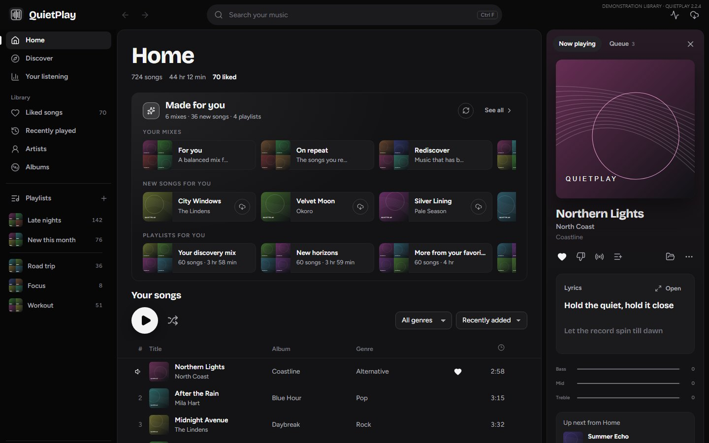
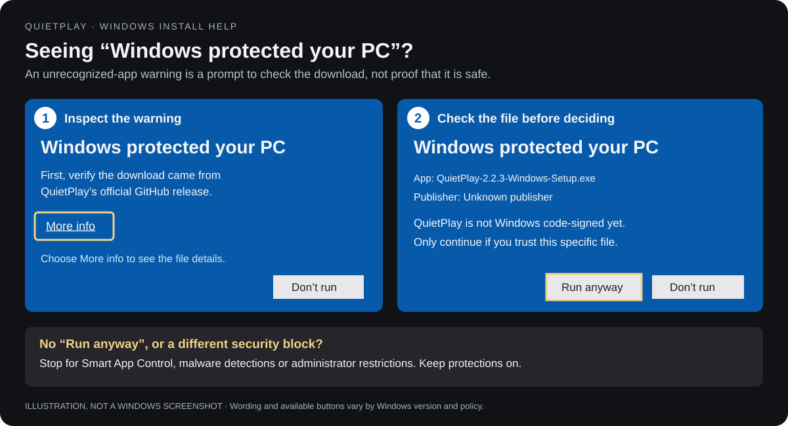
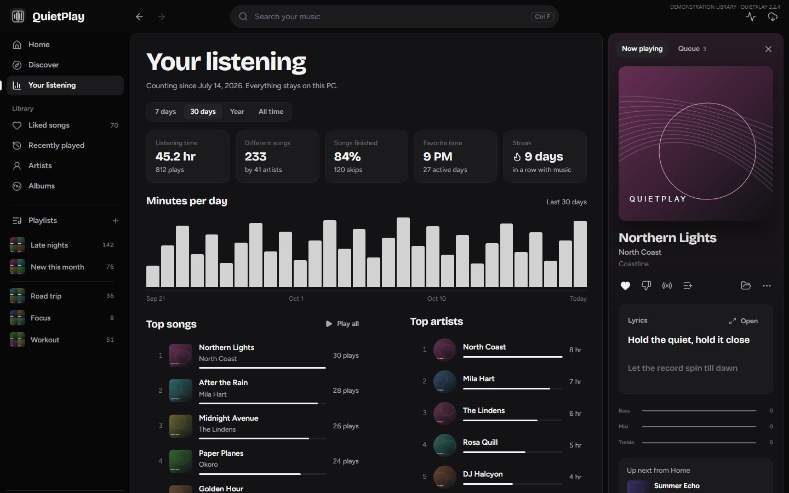
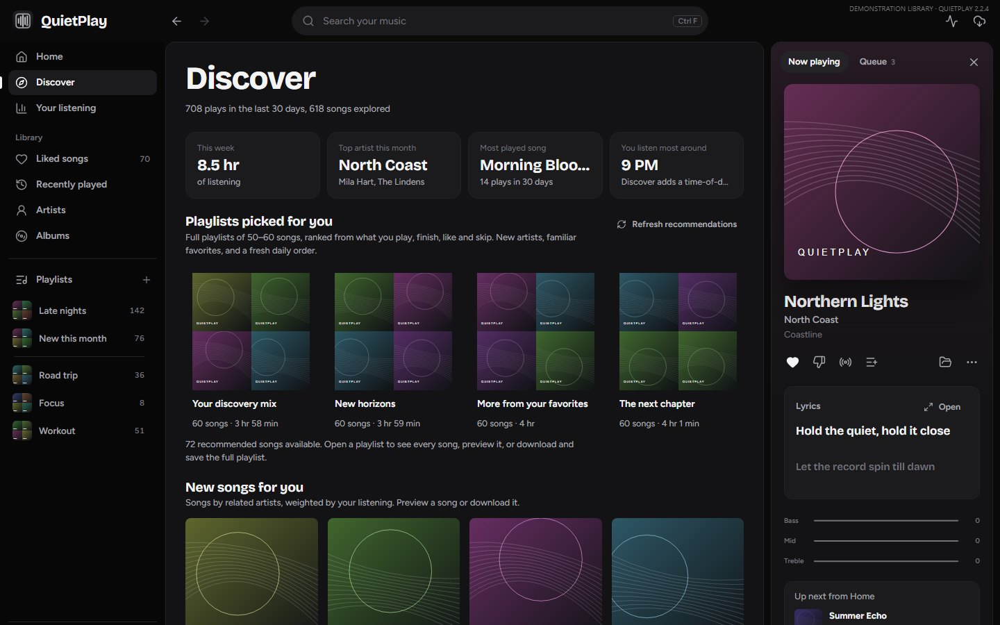
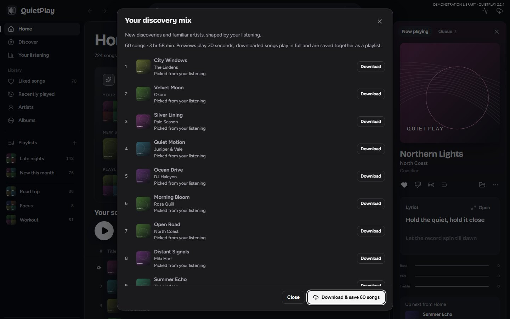
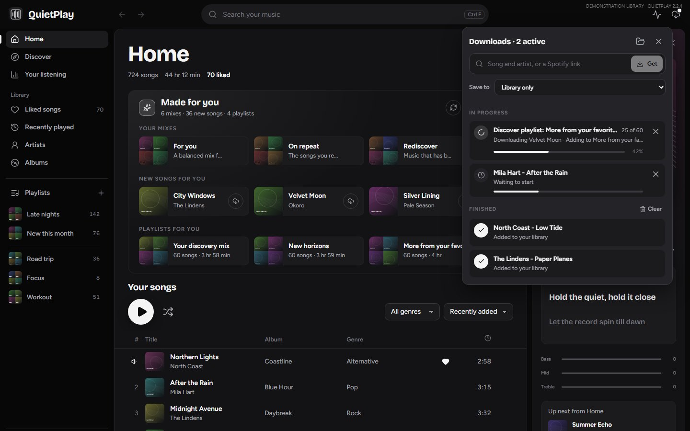
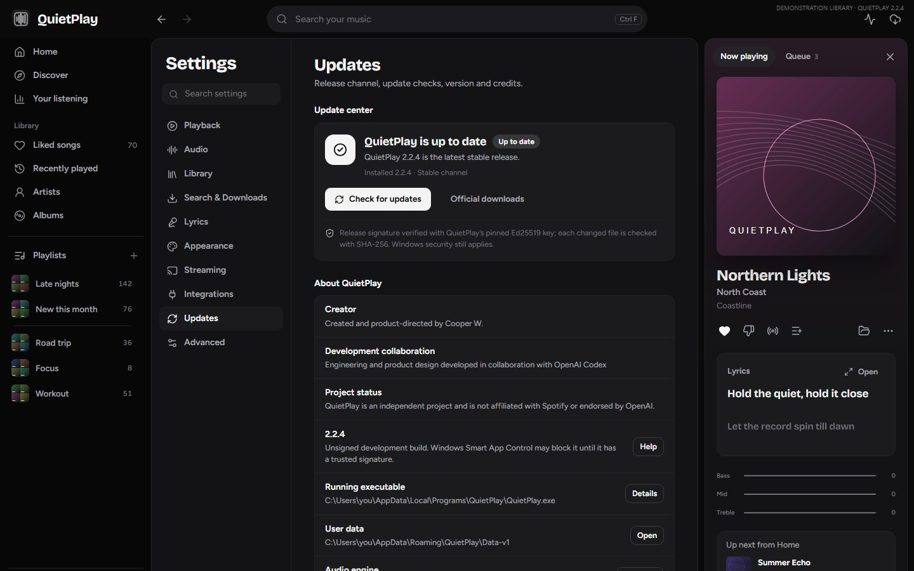

# QuietPlay

**A music player for the songs on your PC, that learns what you like.**

QuietPlay 2.2.8 is a redesigned Windows app: a clean black-and-grey interface,
synced lyrics, smart mixes and radio built only from your own listening, your
listening stats, playlists, a mini player, Windows media controls and OBS
streaming tools. No account, no subscription and no upload of what you play.

**[Download QuietPlay 2.2.8 for Windows](#get-quietplay)** &nbsp; / &nbsp;
**[Install guide](#install-quietplay)** &nbsp; / &nbsp;
**[What's new](CHANGELOG.md)** &nbsp; / &nbsp;
**[Request a feature](https://github.com/cooperwwwwww/QuietPlay-downloads/issues/new?template=feature_request.yml)** &nbsp; / &nbsp;
**[Report a bug](https://github.com/cooperwwwwww/QuietPlay-downloads/issues/new?template=bug_report.yml)**

[User guide](USER_GUIDE.md) | [FAQ](FAQ.md) | [Changelog](CHANGELOG.md) |
[Platforms](PLATFORMS.md) | [Roadmap](ROADMAP.md) | [Get help](https://github.com/cooperwwwwww/QuietPlay-downloads/issues/new?template=help.yml)

*QuietPlay, shown with fictional demonstration songs and artwork. Your library starts with your own music.*

## Get QuietPlay

<!-- release-summary:start -->
**Latest release: QuietPlay 2.2.8** (October 2026)

| Download | For | File |
| --- | --- | --- |
| **[Download for Windows](https://github.com/cooperwwwwww/QuietPlay-downloads/releases/download/v2.2.8/QuietPlay-2.2.8-Windows-Setup.exe)** | Windows 10 or 11, 64-bit | `QuietPlay-2.2.8-Windows-Setup.exe` |

[Release notes and checksum](https://github.com/cooperwwwwww/QuietPlay-downloads/releases/tag/v2.2.8) | [All versions](https://github.com/cooperwwwwww/QuietPlay-downloads/releases)
<!-- release-summary:end -->

**Mac, Linux and Chromebook:** QuietPlay 2.2.8 is Windows-only. The older
experimental **1.54.1 Beta** packages are still available on its
[release page](https://github.com/cooperwwwwww/QuietPlay-downloads/releases/tag/v1.54.1-development).
See the [platform guide](PLATFORMS.md).

**Requirements:** Windows 10 or 11 (64-bit), a working audio output and the
Microsoft Edge WebView2 Runtime (built into Windows 11; setup installs it if it
is missing). Internet is only needed for lyrics, cover art, suggestions,
online search and downloads, not for playing your songs.

## Install QuietPlay

1. Select **Download for Windows** above. The file is
   `QuietPlay-2.2.8-Windows-Setup.exe`.
2. Open it. Windows may show a SmartScreen warning because QuietPlay is not
   code-signed yet; read the [security notice](#windows-security-notice).
3. Follow setup. The optional VB-CABLE driver archive is included for separate
   OBS audio. Normal listening does not need the driver.
4. Open **QuietPlay** from the desktop or Start menu.

Upgrading from 1.x keeps your library, playlists, likes, listening history and
settings. The app, FFmpeg and the optional downloader are all included; there is
nothing else to install.

### Windows Security Notice

QuietPlay **2.2.8 is not Windows code-signed yet**. Microsoft Defender
SmartScreen may show **Windows protected your PC** when you open the installer.
An unrecognized-app warning does not prove a download is safe or malicious.

1. Check that you downloaded **QuietPlay-2.2.8-Windows-Setup.exe** from
   [this official release](https://github.com/cooperwwwwww/QuietPlay-downloads/releases/tag/v2.2.8).
   You can [compare its SHA-256 checksum](FAQ.md#check-the-downloaded-file).
   A matching checksum confirms file identity; it does not prove safety.
2. On **Windows protected your PC**, select **More info**. Check the filename
   and publisher. This unsigned build may show **Unknown publisher**.
3. If you trust that specific file and accept the risk, select **Run anyway**,
   **only if Windows offers it**. If you are unsure, choose **Don't run**.
4. If there is no **Run anyway**, or you see **Smart App Control**, a malware
   detection or an administrator restriction, **stop**. Keep Windows security
   protections on; ask your administrator or [report the exact warning](https://github.com/cooperwwwwww/QuietPlay-downloads/issues).
   Do not post private details from your PC.

The image is an illustration; wording varies by Windows version and policy.
See the [full warning guide](FAQ.md#windows-protected-your-pc),
[Microsoft's SmartScreen explanation](https://learn.microsoft.com/en-us/windows/apps/package-and-deploy/smartscreen-reputation)
and [Smart App Control FAQ](https://support.microsoft.com/en-us/windows/security/threat-malware-protection/smart-app-control-frequently-asked-questions).

## Start Listening

On the first launch, choose **Add music** for individual songs or **Add folder**
for a whole collection. You can also drag audio files or folders onto QuietPlay.
Your library starts empty until you add music; no account is needed.

Select a song and press **Play**. To use the optional online search and downloader,
see the [download guide](USER_GUIDE.md#search-and-download-music). Only download
recordings you have permission to save.

## What QuietPlay Can Do

| | |
| --- | --- |
| **Home** | One **Made for you** box with your local mixes, new songs to preview or download and full 50–60-song playlists, then your whole library with Play, Shuffle, genre filter and sorting. Recommendations stay loaded as you move between tabs. |
| **Discover** | Personalized 50–60-song playlists with previews and Download & save, expanded online recommendations with Show more, Made for you, time-of-day mix, On repeat, Because you played…, Forgotten favorites, Deep cuts, genre mixes, plus **Artists you might like** (picked from what listeners of your favorite artists also play) and **New from your artists**, with 30-second previews. |
| **Radio and autoplay** | Song radio and artist mixes use the songs you actually play after each other. When a list ends, autoplay keeps going with similar songs. Smart shuffle never repeats an artist back to back. |
| **Your listening** | Listening time, top songs, artists and genres, minutes per day, favorite hour and streak, for 7 days, 30 days, a year or all time. Every song has its own listening stats. |
| **Recently played** | Every play, grouped by day, with what you finished and what you skipped. |
| **Search** | Finds songs, artists, albums and playlists as you type, ignores accents and punctuation, and still finds "jak jonson" when you misspell it. Ctrl+K plays anything instantly. |
| **Lyrics** | Synced lyrics that follow the song, saved with your files when possible, with a per-song timing adjustment. |
| **Library care** | Finds duplicate copies of songs and keeps the best one, reconnects songs you moved, tidies up empty and copied playlists, finds missing covers, gives each artist one genre checked against MusicBrainz, Deezer and Apple (with a review screen to change any of them), and lets you set the genre or album for many songs at once. |
| **Playlists** | Create, reorder, pin, import and export (M3U8 or JSON), and undo deletes. |
| **Playback** | Crossfade, queue, speed control, live EQ, normalization, sleep timer, output that follows the device your PC is using (or a device you choose), mini player, media keys, taskbar buttons and Ctrl+Alt shortcuts that work from any app, even in games. |
| **Look and feel** | Black, grey, light, midnight, colorful, high-contrast and custom themes, a real-audio visualizer and reduced motion. |
| **OBS** | Guided OBS setup, a now-playing overlay and separate stream audio. |

*Demonstration statistics; your listening information stays on your PC.*

Reopening restores the song and position you left off at, and waits for you to
press Play.

## Optional Online Search and Downloads

The search bar can also show online results. Downloads use the bundled spotDL
companion, which reads Spotify metadata and matches audio from other providers.
It does not download protected Spotify audio or give you rights to a recording;
only save music you have permission to download.
If a song cannot be downloaded from your chosen source, QuietPlay tries
YouTube Music, YouTube, SoundCloud and Bandcamp, then a broader search, before
reporting it as failed. When Spotify cannot provide song details, searches and
Spotify song links use Apple's public music catalogue instead.
[Download guide](USER_GUIDE.md#search-and-download-music).

## Discover and Full Playlists

Discover recommends songs and complete **50–60-song playlists** from your listening.
Open a playlist to see every song, download individual songs, or **Download & save**
the whole mix. Catalog previews appear when a preview is available.

| Discover recommendations | Open a full playlist |
| --- | --- |
|  |  |

| Downloads | Updates |
| --- | --- |
|  |  |

*All pictures use fictional demonstration data. Click a picture to view it larger.*

## New in 2.2.8

- **Plays where your PC plays:** with Output set to System default, playback
  follows the device Windows is using. Connect headphones or a speaker and the
  music moves there, keeping your place; disconnect it and it moves back.
- **No manual refresh:** the output list in Settings updates by itself when
  devices are connected or removed.
- **Missing device, no silence:** if the device you chose is not connected,
  QuietPlay uses your PC's current device and switches back when yours returns.

### New in 2.2.7

- **Downloads that keep trying:** if a song fails on your chosen source,
  QuietPlay tries YouTube Music, YouTube, SoundCloud and Bandcamp, then a
  broader search. Only songs that fail everywhere are reported.
- **Fixed YouTube Music downloads**, which could not start in earlier versions.
- **Works when Spotify is down:** searches and Spotify song links fall back to
  Apple's public music catalogue, preferring the original recording over covers
  and remixes. Album and playlist links still need Spotify.

### New in 2.2.4

- **Made for you on Home:** one box brings together your local mixes, new songs
  and full 50–60-song recommended playlists, with your songs right below.
  Click a recommended song to preview it; open a playlist to download and save it.
- **Faster, steadier Home:** recommendations stay loaded when you switch tabs
  instead of reloading, and rows remember where you scrolled.
- **Reliable playlist downloads:** fixed recommended playlists failing with
  "Could not get client token". Playlists keep their order, and one song that
  cannot be found no longer stops the rest.
- **Redesigned Downloads, Update center and updater window**, with clear progress
  for active and finished downloads and one clear update action.

### Official Updater (2.2.2 and Later)

- **Official updater:** signed release manifests, changed-file downloads,
  progress and cancellation, **Update and restart**, startup checks and recovery.
  Future updates reuse existing app files instead of reinstalling the full app.
  [How to update](#updates-and-support).

### Playlist Features (2.2.1 and Later)

- **Full personalized playlists:** Discover builds playlists of **50–60 different
  songs** from your listening habits when enough recommendations are available.
  Open every song, preview tracks, or **Download & save** the whole playlist.
- **More recommendations:** a larger pool of related artists, picks from your
  favorite artists, and **Show more** for additional song suggestions.
- **Complete playlist search:** paste a Spotify playlist or album link to see
  all returned songs. **Download all** queues the complete collection.

[Personalized playlist guide](USER_GUIDE.md#personalized-playlists) |
[Release notes](CHANGELOG.md#228---plays-where-your-pc-plays)

## In Development

The following features are **not included in the 2.2.8 installer**:

- **Custom OBS overlays:** six visual color pickers, background transparency,
  fonts, artwork placement, borders, sizing, visible details and presets. A live
  preview uses the same renderer as OBS, and small sources scale to fit.
  [Overlay customization guide](USER_GUIDE.md#overlay-customization-unreleased).
Nothing here requires an account or uploads your music. Follow the
[unreleased changelog](CHANGELOG.md) for development progress.

## Data and Privacy

- Your library, playlists, history and settings stay on your PC
  (`%APPDATA%\QuietPlay`). Nothing you play is uploaded.
- Mixes, radio, autoplay and stats are calculated on your PC.
- When turned on, lyrics (LRCLIB), cover art and genres (MusicBrainz, Deezer,
  Apple) receive the song details they need. Suggestions (**Artists you might
  like**, **New from your artists**) send only the names of your most-played
  artists to Deezer's and Apple's public music catalogs. Each can be turned off
  in Settings.

## Updates and Support

**QuietPlay 2.2.8 includes the official file updater.** It checks official stable
releases in the background, but downloads and installs only when you ask.

1. Open **Settings → Updates → Check for updates**.
2. Choose **Download changed files** (**Download update** from 2.2.4). The update
   screen shows the download size.
3. Choose **Update and restart**, then approve. QuietPlay saves and closes,
   updates changed app files, checks startup and reopens.

Each release manifest is signed with QuietPlay's release key. The updater checks
that signature, the package size and SHA-256 hashes before applying files. A
failed or interrupted update restores the previous app. Your music, library,
playlists, history and settings stay in place. This release-key signature is
separate from Windows Authenticode; the app is still not Windows code-signed,
and Windows security checks remain enabled.

**Already on 2.2.7:** use the app's update screen to reach 2.2.8 with about
**7.8 MB** of changed files. From **2.2.4** it is about **24.8 MB**, and from
**2.2.2 or 2.2.3** about **40.1 MB**. Version **2.2.1** can run
**[QuietPlayUpdater.exe](https://github.com/cooperwwwwww/QuietPlay-downloads/releases/download/v2.2.8/QuietPlayUpdater.exe)**
from the official 2.2.8 release for a direct update of about **40.2 MB**.
Version **2.2.0** needs one manual 2.2.8 setup to enable future file updates.
A full setup remains available for new PCs, repairs or versions without a
matching update package.

| Need help with | Where to go |
| --- | --- |
| Getting started | [User guide](USER_GUIDE.md) and [FAQ](FAQ.md) |
| An installation question | [Ask for help](https://github.com/cooperwwwwww/QuietPlay-downloads/issues/new?template=help.yml) |
| Something broken | [Report a bug](https://github.com/cooperwwwwww/QuietPlay-downloads/issues/new?template=bug_report.yml) |
| An idea | [Request a feature](https://github.com/cooperwwwwww/QuietPlay-downloads/issues/new?template=feature_request.yml) |

Feedback is public: don't attach music files, passwords or unredacted logs.
[Feedback guide](CONTRIBUTING.md). This repository hosts downloads,
documentation and feedback; the app's source is private.

## Credits

Created and product-directed by **Cooper W.** Engineering and product design
developed in collaboration with **OpenAI Codex**; the 2.2 redesign was developed
in collaboration with **Claude** by Anthropic.

QuietPlay is independent, is not affiliated with Spotify or Apple, and is not
endorsed by OpenAI or Anthropic. Third-party notices and licenses are included
in the installed app under *Release Evidence*.

