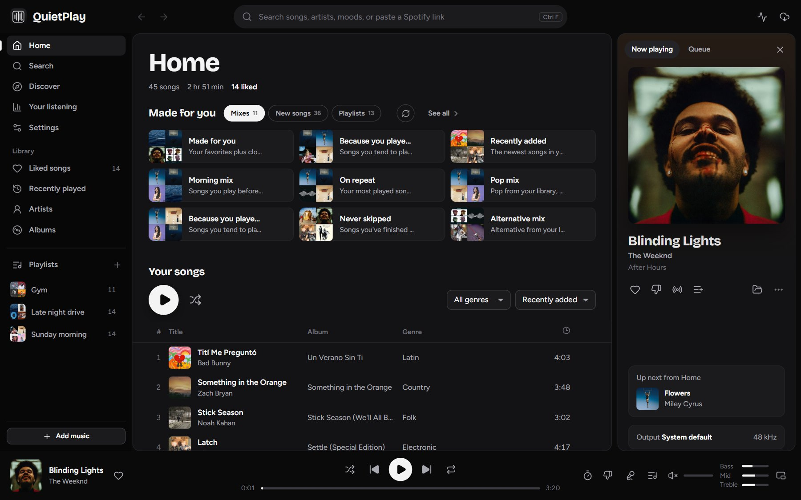
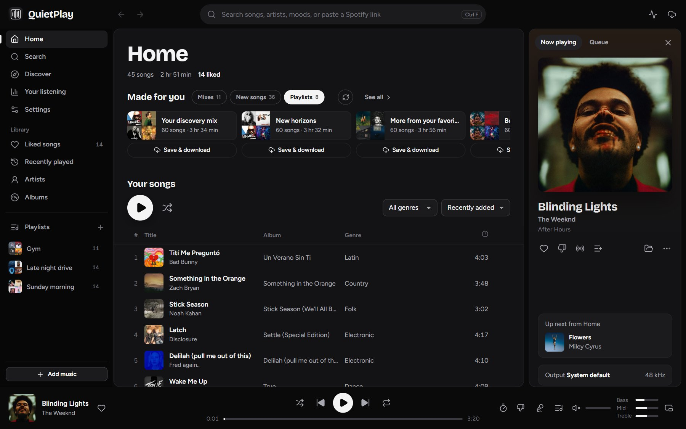
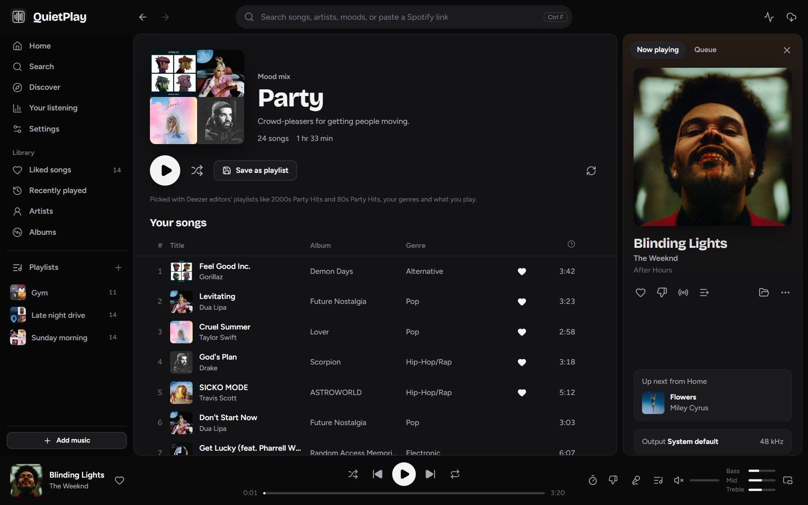
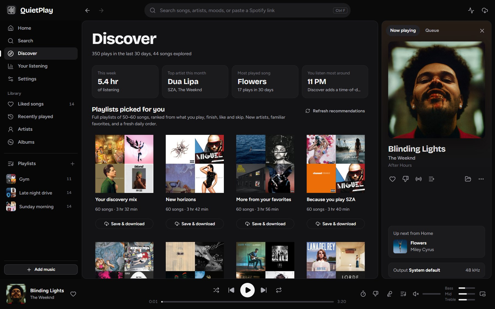
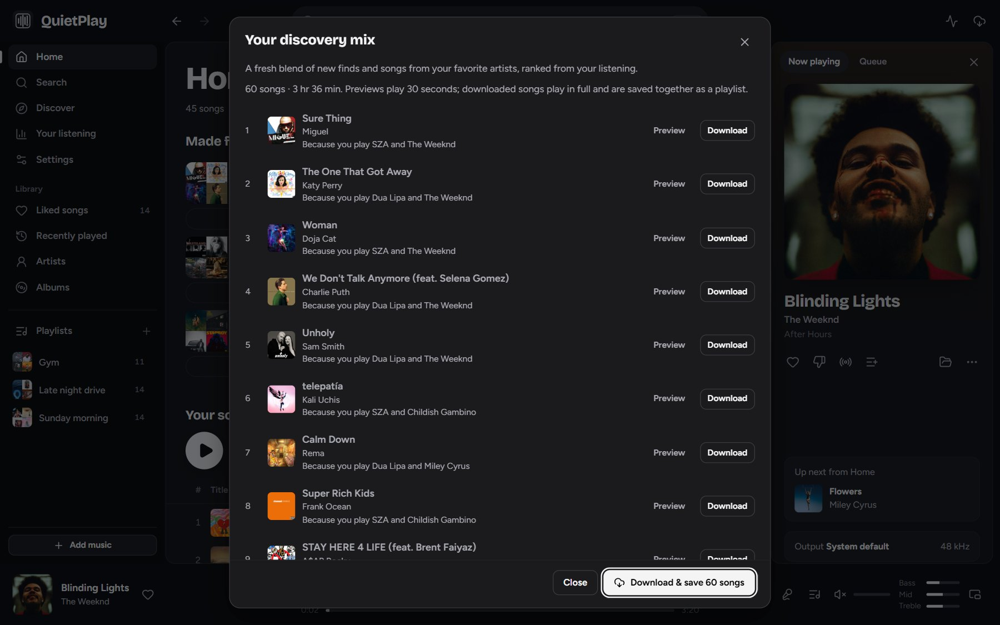
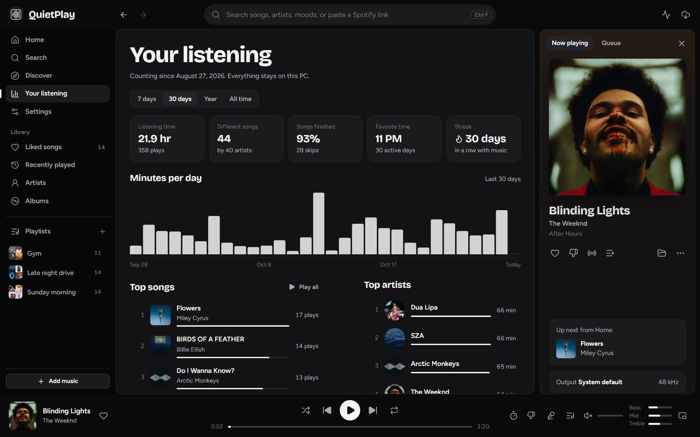
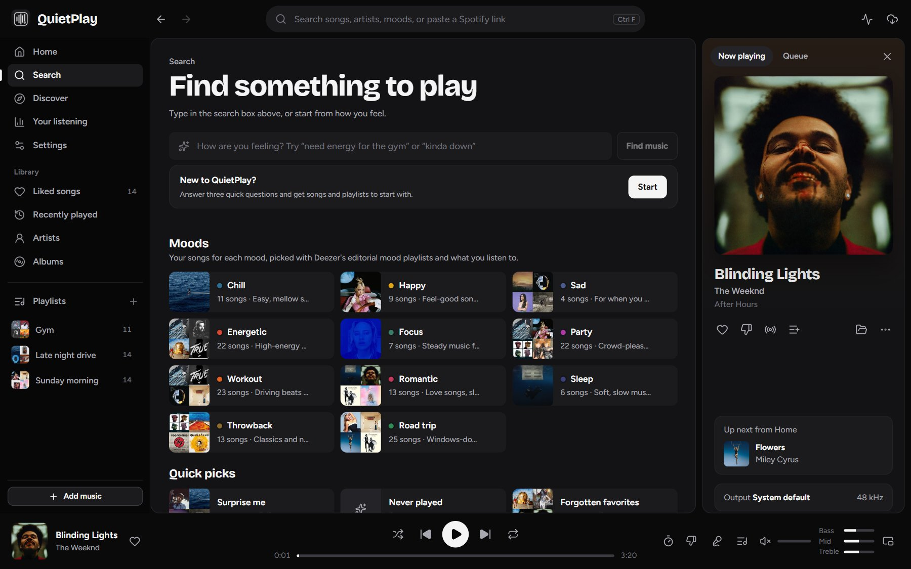

# QuietPlay

**A free music player for Windows that plays the songs on your PC and learns what you like.**

No account. No subscription. Nothing you play leaves your computer.

Version 2.2.24 · [What's new](#new-in-2224) · [Help](FAQ.md) · [Report a problem](https://github.com/cooperwwwwww/QuietPlay-downloads/issues/new?template=bug_report.yml)

## Install in three steps

1. **Click the button above.** Your browser downloads `QuietPlay-2.2.24-Windows-Setup.exe`.
2. **Open the file.** If Windows says *"Windows protected your PC"*, choose **More info**, check the
   file name, then **Run anyway**. This shows up because QuietPlay is new and not code-signed yet;
   [why this happens](#windows-security-notice).
3. **Follow setup**, then open **QuietPlay** from the Start menu and choose **Add music** to add a
   folder of songs.

Already have QuietPlay? It updates itself: when a new version is out you'll see **Update now** in
the app. One click, and your music, playlists and settings stay in place.

## A look inside

| Your music, mixes and recommendations | Moods made from your library |
| --- | --- |
|  |  |
| **Discover new music** | **Full playlists you can save and download** |
|  |  |
| **Your listening** | **Search, moods and quick picks** |
|  |  |

*Screenshots of QuietPlay 2.2.24 with a demo library of well-known songs.*

## What it does

- **Plays your music:** MP3, FLAC, M4A, OGG and WAV, with crossfade, an equalizer, a sleep timer,
  synced lyrics and a mini player.
- **Made for you:** daily mixes, radio and full 50–60-song playlists built from what you actually
  play, finish, like and skip.
- **Moods:** say how you feel ("need energy for the gym") and get a mix from your own songs.
- **Find new music:** recommended songs and playlists you can preview, then save and download
  in one click.
- **New here?** A short, skippable quiz gives you songs and playlists to start with, and you can
  import your taste from Spotify, Apple Music, YouTube Music and other apps with TuneMyMusic.
- **Your listening:** time listened, top songs, artists and genres, streaks and favorite hours.
- **Looks the way you like:** dark, light and colorful themes, plus a live visualizer.
- **Plays where Windows plays:** follows your headphones and speakers, and asks before switching
  to a device you just connected.
- **For streamers:** a now-playing overlay for OBS and separate stream audio.

Only download music you have permission to save.

## New in 2.2.24

- **One-click updates, ready at launch:** QuietPlay checks while it opens; **Update now** downloads,
  installs and restarts on its own.
- **Smooth audio while recommendations refresh,** and new headphones or speakers noticed within
  about a second.
- **Previews keep working** after recommendations have been open a while.
- **One place to bring things in:** Settings → Playback → **Import your music** (backups too).
- **The new black-and-white logo** on shortcuts and the taskbar.

### New in 2.2.23

- **Import your music, the way Spotify does it,** with TuneMyMusic.
  [How to](USER_GUIDE.md#bring-your-taste-from-other-apps)
- **More new songs on Home:** up to 90.

### New in 2.2.20

- **One-click updates:** QuietPlay tells you when an update is ready. Press **Update now** and
  it downloads, installs and restarts on its own.
- **Remove songs from the queue** without deleting or disliking them.
- **Sleep timer** one click away in the player bar.
- **Settings in the sidebar**, a close button, Audio first, and the visualizer under Appearance
  (Spectrum is the new default).
- **Made for you** is now a tidy row on Home with Mixes, New songs and Playlists tabs.
- **Faster:** online search results in about a third of a second, and recommendations and mood
  pages that open instantly.
- **Audio follows Windows**, and asks when you connect new headphones or speakers.
- **VB-CABLE for OBS** installs from inside the app with one approval.

[Full changelog](CHANGELOG.md)

## Windows security notice

QuietPlay 2.2.24 is not Windows code-signed yet, so Microsoft Defender SmartScreen may show
**Windows protected your PC**. That warning means Windows doesn't recognize the app yet; it doesn't
say the file is harmful.

1. Make sure you downloaded `QuietPlay-2.2.24-Windows-Setup.exe` from
   [the official release](https://github.com/cooperwwwwww/QuietPlay-downloads/releases/tag/v2.2.24). You can
   [compare its checksum](FAQ.md#check-the-downloaded-file).
2. Choose **More info**, check the file name, then **Run anyway** only if Windows offers it.
3. If there is no **Run anyway**, or you see Smart App Control or a malware warning, stop and
   [ask for help](https://github.com/cooperwwwwww/QuietPlay-downloads/issues/new?template=help.yml). Keep Windows security turned on.

## Updates

QuietPlay checks for updates by itself and shows **Update now** when one is ready. Updates only
replace the app files that changed (usually a few megabytes), are signed and checked before they
are applied, and restore the previous version if anything goes wrong.

On a version older than 2.2.16? Open **Settings → Updates → Check for updates**. Version 2.2.1 can
run [QuietPlayUpdater.exe](https://github.com/cooperwwwwww/QuietPlay-downloads/releases/download/v2.2.24/QuietPlayUpdater.exe); version
2.2.0 needs the installer once. [All versions](https://github.com/cooperwwwwww/QuietPlay-downloads/releases)

## Requirements

Windows 10 or 11 (64-bit). Setup installs everything QuietPlay needs. The internet is only used
for lyrics, cover art, recommendations, online search and downloads; your music plays offline.
Mac and Linux: see the [platform guide](PLATFORMS.md).

## Privacy

Your library, playlists, history and settings stay on your PC (`%APPDATA%\QuietPlay`). Mixes,
radio and stats are worked out on your PC. Online features send only what they need (for example
a song name to find its lyrics) and each can be turned off in Settings. Files you import from
other apps are read on your PC; QuietPlay never asks for your passwords. TuneMyMusic is a separate
service with its own terms and privacy policy.

## Help

| | |
| --- | --- |
| How do I…? | [User guide](USER_GUIDE.md) · [FAQ](FAQ.md) |
| Something isn't working | [Report a problem](https://github.com/cooperwwwwww/QuietPlay-downloads/issues/new?template=bug_report.yml) |
| I have an idea | [Request a feature](https://github.com/cooperwwwwww/QuietPlay-downloads/issues/new?template=feature_request.yml) |

Please don't attach music files, passwords or unedited logs; issues are public.
This repository hosts downloads, documentation and feedback; the app's source is private.

## Credits

Created and product-directed by **Cooper W.**, developed in collaboration with **OpenAI Codex** and
**Claude** by Anthropic. QuietPlay is independent and not affiliated with Spotify, Apple, Deezer,
OpenAI or Anthropic. Third-party notices are included in the installed app under *Release Evidence*.
